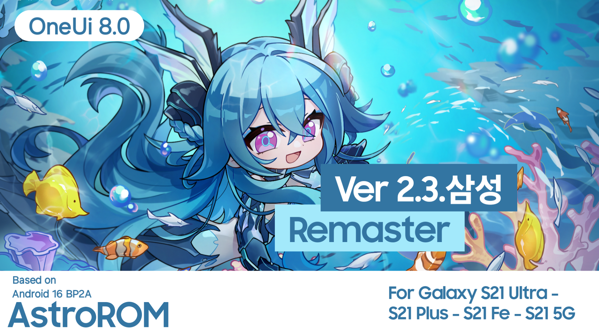

<h1 align="center">
  
</h1>
<p align="center">
  <a href="https://github.com/SameerAlSahab/ProjectAstro/blob/main/LICENSE"></a>
  <a href="https://github.com/yourapril01/OneArcade/actions"></a>
  <a href="https://github.com/yourapril01/OneArcade/commits/OneUI8"></a>
  <a href="https://github.com/SameerAlSahab/ProjectAstro/stargazers"></a>
  <a href="https://github.com/SameerAlSahab/ProjectAstro/network/members"></a>
</p>

## About AstroROM
AstroROM is an independent ROM project designed with a unique approach to firmware modification. Unlike traditional ROM projects, AstroROM automatically adapts and patches any Samsung ROM, regardless of device model or firmware version. Simply match the GitHub branch to your ui version, and AstroROM handles the rest.

---

## ✨ Features

##  AI
- All AI features from Galaxy S25 Ultra

## Misc
- All flagship features 
- Battery health and charging cycles info
- Multiuser support enabled
- Dialogue booster AI in sound
- Fullscreen wallpaper Always on Display
- Adaptive color tone
- Outdoor mode
- Custom font support 
- Official status in device information
- Heavily debloated
- Bluetooth library patched
- Smart Manager China
- Samsung encryption removed
- Fixed Knox apps (Secure Folder,Secure WiFi,Private Share,Health etc)
- Fixed samsung wearables 
- Inbuilt PUI theme 
- Disabled secure screenshot detection
- Fixed SmartView
- Unlimited google photos storage with original quality 
- Enables some hidden device features
- And many more!

## CSC Features
- Network speed Meter
- AppLock support
- Data usage display on notification shade
- Firewall
- App blocker and permission manager
- AltZlife
- Native call recording
- And many more 

## Extras
- 4K/120FPS & log video
- Zoom slider and flagship camera features 
- Adaptive refresh rate etc.
  
* This features vary upon devices and platform.
  
---

## Special Thanks
This project wouldn't be possible without the incredible work of:

- **[Salvo Giangreco](https://github.com/salvogiangri)** - The man behind the **[UN1CA](https://github.com/salvogiangri/UN1CA)** project and a true leader in the Samsung community. The initial ideas and inspiration that made AstroROM possible. 
- **[BlassGO](https://github.com/BlassGO)** - For his Dynamic Installer.
- **[Danda420](https://github.com/Danda420)** - For his genfscontexts.
- **[topjohnwu](https://github.com/topjohnwu)** - For samloader.rs , which we use for download latest firmwares
- **[3arthur6](https://github.com/3arthur6)** - For bluetooth library patcher.
- **[soulr344](https://github.com/soulr344/OMCDecoder)** - For omc decoder.
---

## Accountability
```cpp
#include <std_disclaimer.h>

/*
* Your warranty is now void.
*
* I am not responsible for bricked devices, dead SD cards,
* thermonuclear war, or you getting fired because the alarm app failed. Please
* do some research if you have any concerns about doing this to your device
* YOU are choosing to make these modifications, and if
* you point the finger at me for messing up your device, I will laugh at you.
*
* I am also not responsible for you getting in trouble for using any of the
* features in this ROM, including but not limited to Call Recording, secure
* flag removal etc.
*/
```

## Licensing
This project is licensed under the **MIT License** - see the [LICENSE](LICENSE) file for details.

- **[android-tools](https://github.com/nmeum/android-tools)** - Licensed under Apache License 2.0
- **[apktool](https://github.com/iBotPeaches/Apktool)** - Licensed under Apache License 2.0  
- **[erofs-utils](https://github.com/sekaiacg/erofs-utils)** - Dual licensed (GPL-2.0, Apache-2.0)
- **[platform_build](https://android.googlesource.com/platform/build)** - Licensed under Apache License 2.0
- **[smali](https://github.com/google/smali)** - Licensed under BSD 3-Clause License
- **[e2fsprogs](https://github.com/tytso/e2fsprogs)** - Licensed under GPL-2.0 / LGPL-2.1
---

## Contributing

Contributors are welcome!